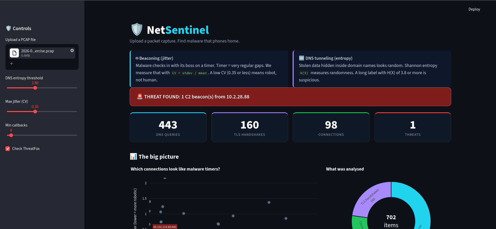
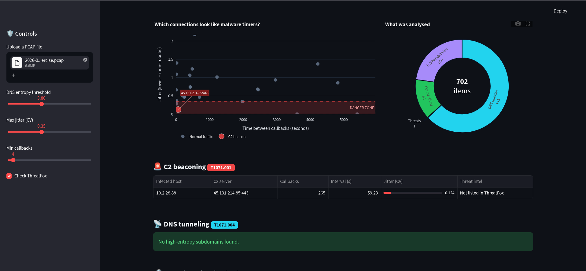
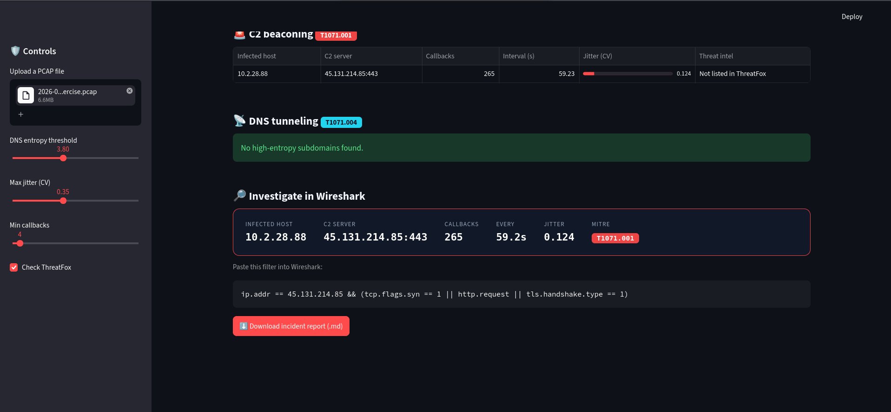
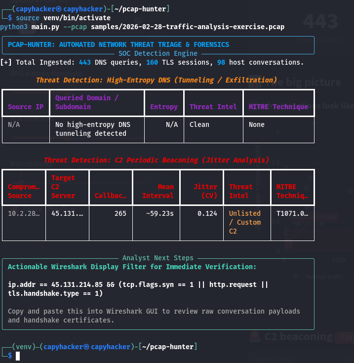
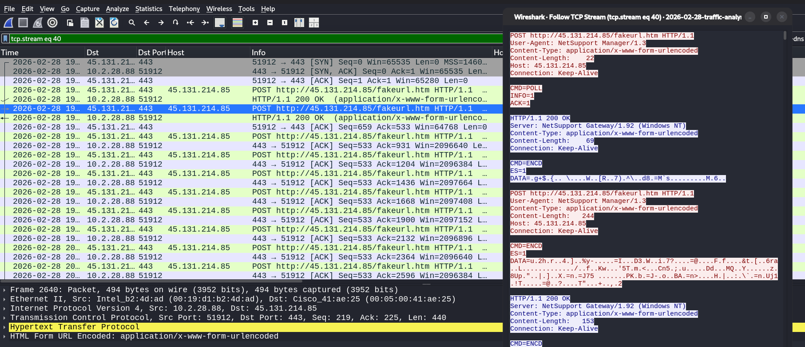

<pre>
  _   _      _   ____             _   _            _ 
 | \ | | ___| |_/ ___|  ___ _ __ | |_(_)_ __   ___| |
 |  \| |/ _ \ __\___ \ / _ \ '_ \| __| | '_ \ / _ \ |
 | |\  |  __/ |_ ___) |  __/ | | | |_| | | | |  __/ |
 |_| \_|\___|\__|____/ \___|_| |_|\__|_|_| |_|\___|_|
      [ AUTOMATED PCAP THREAT TRIAGE & C2 PROFILER ]
</pre>

# 🛡️ PCAP-Hunter (NetSentinel)
### **When Static Blocklists Go Blind, Mathematical Telemetry Hunts.**

 

> **🚨 THE WAR-ROOM SCENARIO:** You are handed a raw `6.6 MB` packet capture (`443` DNS queries, `160` TLS handshakes and `98` conversation flows). The suspicious server `45.131.214.85` has no listing in Abuse.ch ThreatFox, so a static blocklist check alone would let it through. Yet, an internal workstation is polling that Command and Control (C2) server about every 60 seconds.  
> **Can your tooling find the implant without relying on known signatures?**

 

 

**[⚡ 30-Second Executive Summary](#-30-second-executive-summary)** • **[🧠 The Math Under the Hood](#-the-mathematics-of-behavioral-hunting)** • **[🕵️‍♂️ Kill-Chain Walkthrough](#️-kill-chain-walkthrough-unmasking-netsupport-rat)** • **[🏗️ Architecture](#️-streaming-memory-architecture)** • **[🚀 Quickstart](#-installation--quickstart)**

---

## ⚡ 30-Second Executive Summary

Modern red teams and ransomware operators treat IP addresses and domains like burner phones—they spin up a cloud VPS, proxy C2 traffic over TCP Port `443`, and burn the infrastructure before public threat feeds ever index it.

**PCAP-Hunter (NetSentinel)** is a behavioral network forensics engine that bypasses static signature blindness. By applying **statistical time-series variance** and **information theory** to raw `.pcap` / `.pcapng` telemetry, it isolates stealthy attacker tradecraft automatically:

| Feature / Attack Vector | Legacy Signature / IOC Scanners | 🛡️ PCAP-Hunter (NetSentinel) |
| :--- | :--- | :--- |
| **Brand-New / Unlisted C2 IPs** | ❌ **Blind** (no blocklist hit) | ✅ **Caught** via Inter-Arrival Jitter Profiling ($CV \le 0.35$) |
| **Port 443 Protocol Masquerading** | ❌ **Misses** cleartext HTTP over TLS ports | ✅ **Caught** by tracking conversation cadence across all ports |
| **DNS Tunneling & Exfiltration** | ❌ **Blind** to custom domains | ✅ **Caught** via Subdomain Shannon Entropy ($H(X) \ge 3.8$) |
| **RAM Usage on Large Captures** | ⚠️ **Can be heavy** (some tools load the full PCAP into RAM) | ⚡ **Streaming, low memory** (`pyshark` streaming with `keep_packets=False`) |
| **SOC Analyst Pivot Time** | 🐢 **15–45 mins** of manual packet scrolling | 🎯 **Instant** copy-ready Wireshark display filter & `.md` Incident Report |

---

## 🧠 The Mathematics of Behavioral Hunting

Attackers can spoof User-Agents, rotate IP addresses, and encrypt payloads—but they cannot easily hide **physics** (payload randomness) or **time** (programmatic sleep loops).

### 🎯 Pillar 1: C2 Heartbeat Jitter Profiling (MITRE ATT&CK T1071.001)
Human network activity is inherently chaotic: a user loads a webpage, pauses for 45 seconds, clicks 3 links rapidly, and locks their screen. Malware implants (Cobalt Strike, Sliver, NetSupport RAT), however, execute inside an automated timer loop.

For every outbound conversation `(src_ip, dst_ip, dst_port)`, `detectors/beaconing.py` extracts packet arrival timestamps $(t_1, t_2, \dots, t_n)$, strips sub-100ms TCP handshake bursts, computes inter-arrival deltas ($\Delta t_i = t_i - t_{i-1}$), and calculates the **Coefficient of Variation ($CV$)**:

$$CV = \frac{\sigma}{\mu} = \frac{\sqrt{\frac{1}{N-1}\sum_{i=1}^{N}(\Delta t_i - \mu)^2}}{\mu}$$

<pre>
  JITTER (CV) SPECTRUM:
  0.00                0.124              0.35                               1.00+
   |--------------------🎯----------------|-----------------------------------|
   [  ROBOTIC / C2 DANGER ZONE (CV<=0.35) ]      [ CHAOTIC HUMAN BROWSING ]
                        ▲
             Flagged NetSupport RAT
          (45.131.214.85:443 | 59.23s)
</pre>

* **Why It Works:** Even when malware introduces 10%–20% sleep jitter to evade naive fixed-second counters, its dispersion relative to the mean ($\sigma / \mu$) stays below **$0.35$**, locking it squarely inside the red **Danger Zone**.

---

### 📡 Pillar 2: DNS Exfiltration & Subdomain Entropy (MITRE ATT&CK T1071.004)
When malware exfiltrates stolen credentials or tunnels C2 commands through DNS queries (`dnscat2`, `iodine`), it packs Base64/Hex chunks into the lowest-level subdomain label (e.g., `4b8f9a1c0d3e7f2a9b8c7d.badguy.com`).

`detectors/dns_entropy.py` strips local multicast noise (mDNS/LLMNR), isolates the subdomain label $X$, and measures character randomness using **Shannon Entropy**:

$$H(X) = -\sum_{i=1}^{n} P(x_i) \log_2 P(x_i)$$

<pre>
  SHANNON ENTROPY H(X) SCALE:
  1.5                 3.2          3.684   3.80                              5.00
   |-------------------|-------------☁️-----|----------------🚨----------------|
   [ STANDARD ENGLISH  ]    Azure CDN Noise  [ ENCRYPTED / EXFILTRATION ZONE ]
                            (Filtered Out)
</pre>

---

## 🕵️‍♂️ Kill Chain Walkthrough: Unmasking NetSupport RAT

We tested **PCAP-Hunter** against a real-world infection capture (`2026-02-28-traffic-analysis-exercise.pcap`). Here is how the engine took the investigation from raw packets to confirmed payload proof:

### ⏱️ Phase 1: Visual Anomaly Isolation (T+02 Seconds)
Upon uploading the `6.6 MB` capture, NetSentinel streamed **443 DNS queries**, **160 TLS handshakes**, and **98 unique conversation flows**. 

While 97 flows scattered harmlessly across the upper human-browsing region, **one destination dropped straight into the red Danger Zone**:

  

* **Compromised Endpoint:** `10.2.28.88`
* **C2 Destination:** `45.131.214.85:443`
* **Heartbeat Cadence:** `265 callbacks` firing every **`59.23 seconds`**
* **Measured Jitter ($CV$):** **`0.124`** *(Robotic 1-minute sleep timer)*
* **Abuse.ch ThreatFox Status:** `Not listed in ThreatFox` *(no match in the ThreatFox feed at analysis time)*

---

### 🎯 Phase 2: One-Click SOC Playbook & Headless CLI Triage (T+04 Seconds)
NetSentinel immediately flagged **`MITRE T1071.001`**, rendered an inline severity bar, generated a one-click **`.md` Incident Report**, and built a surgical **Wireshark Display Filter**:

  

 

> **💻 Built for Terminal-First Threat Hunters Too:** Prefer working over SSH without a browser? Running `main.py` delivers the exact same telemetry inside a colorized **Rich CLI** interface:

  

---

### 🔥 Phase 3: Smoking-Gun Payload Proof in Wireshark
Pasting NetSentinel's auto-generated pivot filter directly into Wireshark:

<pre>
ip.addr == 45.131.214.85 && (tcp.flags.syn == 1 || http.request || tls.handshake.type == 1)
</pre>

And opening `Follow TCP Stream` (`tcp.stream eq 40`) exposed the attacker's exact tradecraft: **cleartext HTTP POST traffic masquerading over port 443** (normally reserved for encrypted HTTPS) controlled by a **NetSupport Manager** gateway (a legitimate remote-admin tool commonly abused as a RAT):

  

<pre>
POST http://45.131.214.85/fakeurl.htm HTTP/1.1
User-Agent: NetSupport Manager/1.3
Content-Type: application/x-www-form-urlencoded
Host: 45.131.214.85
Content-Length: 21

CMD=POLL&INFO=1&ACK=1
</pre>

---

## 🏗️ Streaming Memory Architecture

Standard Python packet parsers crash when handed large PCAPs because they load every dissected packet object into system RAM. **PCAP-Hunter** enforces `keep_packets=False` inside `pyshark.FileCapture` generators—streaming only lightweight protocol metadata through `tshark`:

<pre>
                         ┌─────────────────────────────────────┐
                         │    📁 Raw Packet Capture (.pcap)    │
                         └──────────────────┬──────────────────┘
                                            │
                                            ▼
                         ┌─────────────────────────────────────┐
                         │  ⚡ Streaming TShark Dissector      │
                         │  core/parser.py (keep_packets=False)│
                         └──────────────────┬──────────────────┘
                                            │
                   ┌────────────────────────┴────────────────────────┐
                   ▼                                                 ▼
    ┌──────────────────────────────┐                  ┌──────────────────────────────┐
    │ 📡 Outbound DNS Query Stream │                  │ 🔄 TCP SYN / HTTP Flow Delta │
    │ (Strip Local mDNS / LLMNR)   │                  │ (src_ip, dst_ip, dst_port)   │
    └──────────────┬───────────────┘                  └──────────────┬───────────────┘
                   │                                                 │
                   ▼                                                 ▼
    ┌──────────────────────────────┐                  ┌──────────────────────────────┐
    │ 🧮 Shannon Entropy Engine    │                  │ ⏱️ C2 Jitter Profiler        │
    │ detectors/dns_entropy.py     │                  │ detectors/beaconing.py       │
    │ H(X) >= 3.8  |  Len >= 20    │                  │ Mean >= 2.0s | CV <= 0.35    │
    │ [MITRE ATT&CK T1071.004]     │                  │ [MITRE ATT&CK T1071.001]     │
    └──────────────┬───────────────┘                  └──────────────┬───────────────┘
                   │                                                 │
                   └────────────────────────┬────────────────────────┘
                                            │
                                            ▼
                         ┌─────────────────────────────────────┐
                         │ 🔍 Abuse.ch ThreatFox IOC Enricher  │
                         │ intel/threatfox.py                  │
                         └──────────────────┬──────────────────┘
                                            │
                   ┌────────────────────────┴────────────────────────┐
                   ▼                                                 ▼
    ┌──────────────────────────────┐                  ┌──────────────────────────────┐
    │ 🖥️ Streamlit SOC Web Console │                  │ 💻 Rich Headless CLI Engine  │
    │ dashboard.py                 │                  │ main.py                      │
    └──────────────┬───────────────┘                  └──────────────┬───────────────┘
                   │                                                 │
                   └────────────────────────┬────────────────────────┘
                                            │
                                            ▼
                         ┌─────────────────────────────────────┐
                         │ 🦈 Auto-Generated Wireshark Filter  │
                         │ + One-Click .MD Incident Report     │
                         └─────────────────────────────────────┘
</pre>

### 📂 Repository Structure

<pre>
pcap-hunter/
├── assets/                  # Visual evidence & forensic case study screenshots
│   ├── 01-dashboard-overview.png
│   ├── 02-cadence-and-telemetry-charts.png
│   ├── 03-threat-tables-and-wireshark-pivot.png
│   ├── 04-cli-triage.png
│   └── 05-wireshark-payload-proof.png
├── core/
│   └── parser.py            # Memory-safe PyShark/TShark streaming generator
├── detectors/
│   ├── beaconing.py         # Inter-arrival delta & Coefficient of Variation (T1071.001)
│   └── dns_entropy.py       # Subdomain Shannon Entropy calculator (T1071.004)
├── intel/
│   └── threatfox.py         # Abuse.ch ThreatFox IOC enrichment client
├── samples/
│   └── 2026-02-28-traffic-analysis-exercise.pcap  # NOT in repo, download it (see samples/README.md)
├── dashboard.py             # Interactive Dark-Mode Streamlit SOC Web Console
├── main.py                  # Headless Rich CLI Triage Engine
├── requirements.txt         # Project dependencies
└── README.md                # Documentation
</pre>

---

## 🚀 Installation & Quickstart

### 1. Install System Dissector (tshark)
<pre>
sudo apt update && sudo apt install -y tshark python3-venv
</pre>

### 2. Clone Repository & Build Virtual Environment
<pre>
git clone https://github.com/wanmuzz/pcap-hunter.git
cd pcap-hunter

python3 -m venv venv
source venv/bin/activate
pip install -r requirements.txt
</pre>

### 3. Launch Mode A: Interactive SOC Web Console (dashboard.py)
<pre>
streamlit run dashboard.py --server.headless true
</pre>
> 🌐 Navigate to **`http://localhost:8501`** in your browser and drag-and-drop `samples/2026-02-28-traffic-analysis-exercise.pcap` into the sidebar.

### 4. Launch Mode B: Headless CLI Triage (main.py)
<pre>
python3 main.py --pcap samples/2026-02-28-traffic-analysis-exercise.pcap
</pre>

---

### 🛡️ Engineered for Blue Teams, SOC Analysts & Threat Hunters
*If this project gave you ideas for your own detection lab, drop a ⭐ on the repo!*

---

## ⚠️ Limitations

- Validated on one public capture so far. Thresholds (CV <= 0.35, entropy >= 3.8, interval >= 2s) were tuned on it and may need adjusting for other networks.
- Beacons with high sleep jitter can raise their CV above the threshold and evade a fixed cutoff.
- Detection is timing-based only. It does not decrypt or inspect encrypted payloads.
- ThreatFox lookups may need an Abuse.ch Auth-Key, depending on the API version.
- Planned: test against my own lab C2 traffic with different jitter settings, and more real-world captures.
